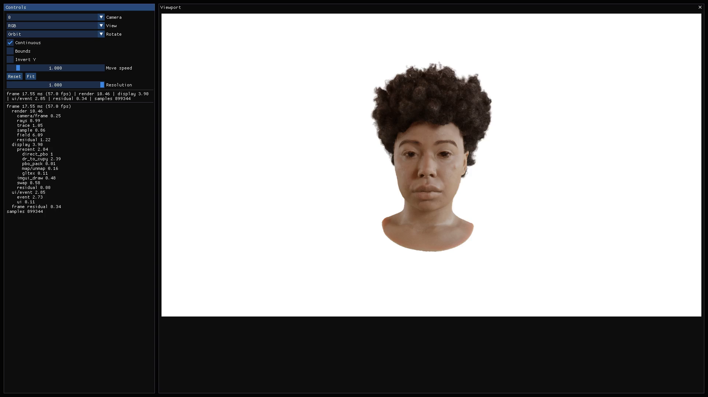

# Open Adaptive Shells

An unofficial implementation of [Adaptive Shells for Efficient Neural Radiance
Field Rendering](https://research.nvidia.com/labs/toronto-ai/adaptive-shells/)
(SIGGRAPH Asia 2023), covering neural-field training, adaptive shell extraction
and GPU rendering in an interactive viewer.



[Video](renderer/docs/media/viewer-demo.mp4)

**1920 x 1080 · 8.3 ms core rendering · RTX 5090**

Khady average, excluding ray generation and display.
See [Performance](renderer/docs/performance.md) for measurements.

## Overview

Adaptive shells bound the region where a neural field contributes to an image,
reducing the number of samples needed for volume rendering. This implementation
includes both learning that field and rendering it within the extracted shells.

```text
Images + cameras -> neural-field training -> inner/outer shell extraction
                 -> shell-guided fine-tuning -> checkpoint + meshes -> GL viewer
```

### Training

[`training/`](training/README.md) builds on SDFStudio/Nerfstudio. Initial training
fits an SDF, a spatially varying kernel and a color field. Shell extraction then
constructs inner and outer meshes around the learned surface, and a second stage
fine-tunes the field with samples restricted to this band.

The geometry network also predicts gradients used for opacity and
normal-dependent color during fine-tuning and rendering. Khady and Horse configs
cover both training stages, shell extraction and loading the result in the viewer.

### Rendering

[`renderer/`](renderer/README.md) is a standalone GPU renderer built with OptiX,
CuPy, Dr.Jit and OpenGL. It traces the shells, evaluates only samples inside the
band and displays the composited image directly from GPU memory.

```text
CuPy camera rays -> OptiX shell intervals -> compact samples
                -> Dr.Jit hash encoding + MLPs -> volume compositing
                -> CUDA PBO -> OpenGL texture
```

The viewer supports orbit and free-look navigation, with selectable diagnostic
views. See [Renderer design](renderer/docs/technical-overview.md) for implementation
details.

## Quick Start

Tested with Windows, RTX 5090, CUDA Toolkit 12.8 and Python 3.10.
Training and rendering use separate environments; see
[installation](docs/installation.md) for setup. Commands below start at the
repository root.

### Train a Scene

Prepare Khady from the official Shelly dataset as described in the
[training guide](training/README.md#dataset), then start initial training:

```nu
cd training
uv run --no-sync ns-train adashell --trainer.load-config configs/examples/khady_stage1.yml
```

Continue with [shell extraction and fine-tuning](training/README.md#shell-extraction).
The guide connects the resulting checkpoint and meshes to the renderer config.

### Open the Viewer

With a checkpoint and shell meshes available:

```nu
cd renderer
uv run adashell-viewer-gl --config repro/khady_stage2_infer_prednorm/khady.json
```

A scene config specifies its checkpoint and shell meshes. Camera presets are
optional; without one, the viewer fits a camera to the scene bounds.

## References

Zian Wang et al. **Adaptive Shells for Efficient Neural Radiance Field Rendering**.
ACM Transactions on Graphics, 2023.
[Paper](https://arxiv.org/abs/2311.10091) /
[Project](https://research.nvidia.com/labs/toronto-ai/adaptive-shells/)

Built with OptiX, Dr.Jit, CuPy, tiny-cuda-nn, GLFW and Dear ImGui.
See [dependency details](renderer/docs/dependencies.md) for versions and licenses.
Training retains the SDFStudio/Nerfstudio [Apache-2.0 license](training/LICENSE);
original renderer code is licensed under [MIT](renderer/LICENSE).
See [Licenses](LICENSE.md) for component-specific terms and attribution.

## Limitations and Differences

- Training is sensitive to hyperparameters. So far, we have obtained usable
  results only on Khady and Horse.
- Rendering speed is still below the performance reported in the paper.
- For faster rendering, the network predicts gradients alongside the SDF
  instead of computing them at each sample. These predictions are used for
  opacity and normal-dependent color.
